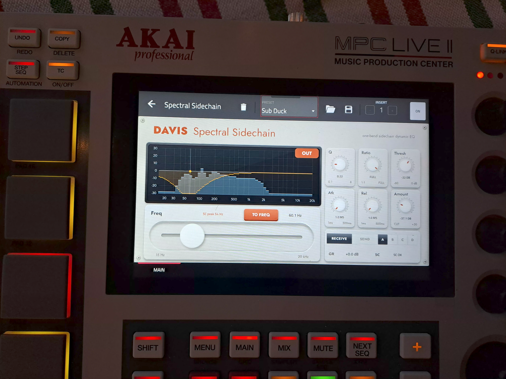
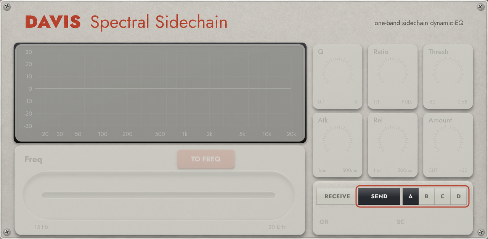
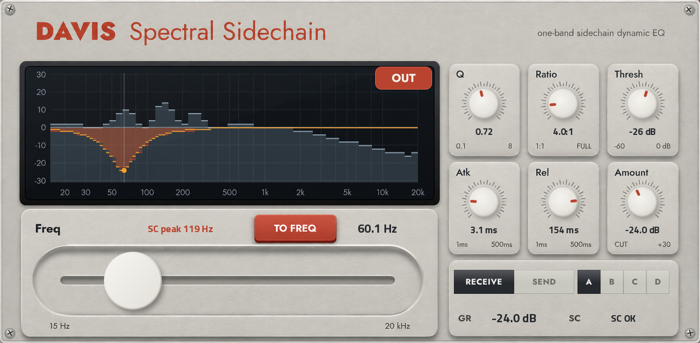

# DAVIS Spectral Sidechain

A one-band **sidechain dynamic EQ** for Akai MPC OS standalone (VST2, MPC OS 3.x, Gen1 armv7: MPC Live / Live II / One / X / Force).
Put the kick on one track and the bass on another: the bass makes room for the kick **only at the kick's frequency and only
while the kick plays**, instead of ducking its whole level.

## How it works
The same plugin goes on two tracks:

- **SEND** on the source track (the kick, say): the audio passes through untouched and a copy goes to a shared channel.
- **RECEIVE** on the track to shape (the bass, a pad, a sample): one bell. **Freq** (15 Hz-20 kHz) places it, **Q** makes it
  wide or narrow. When the source goes above **Thresh**, the band moves towards **Amount** (CUT = -60 dB .. +30 dB);
  **Ratio** (1:1-20:1, FULL) sets how far over Thresh the source must go to get all the way there; **Atk** and **Rel**
  (1-500 ms) set how fast. The detector listens to the source through the same band, so only the part of the kick that
  clashes acts.
- **CHAN A-D** pairs SENDs with RECEIVEs. Any number of RECEIVEs can listen to one channel; several instances on one
  track stack (e.g. a sample that makes room for the kick on A and for the bass on B).

In SEND mode only RECEIVE/SEND and A-D do anything, so the rest of the screen is hidden and a red frame marks them.

## The screen
- **Graph** (15 Hz-20 kHz, +-30 dB): the band at full Amount (orange), what it is doing right now (semi-transparent red curve
  and the orange dot). The graph is for looking only: the Freq slider and the knobs set the band.
- **OUT** (top right corner of the graph): shows the spectrum of the plugin's output, so you see the hole the kick opens in the bass.
  Off by default; while off it costs nothing. Its level scale is its own (-66..-6 dBFS over the graph's height), not the +-30 dB of the curves.
- **SC peak** is the source's strongest frequency (averaged over ~2 s, so a kick's body wins over its click); **TO FREQ** puts
  the band there. A big Freq slider for a finger.

## Install
1. MPC (OS 3.x): in Preferences, turn on **Enable Enhancements** and **External Plugin Support**.
2. Unzip `DAVIS-Spectral-Sidechain-<version>-VST2-Plugins.zip` and copy the folder **`DAVIS - VST - Spectral Sidechain`** into
   the **`VST2 Plugins`** folder of the MPC's internal drive, SD card or USB drive you use for plugins.
3. Restart the MPC. The plugin is under the insert effects as **Spectral Sidechain** (DAVIS).

Or install the release zip from the [Open MPC catalog](https://open-mpc.github.io/) with the installer app or the Plugin Manager VST.

Quick start: kick track insert = Spectral Sidechain, **SEND**, **A**. Bass track insert = Spectral Sidechain, **RECEIVE**, **A**;
play the kick, press **TO FREQ**, set Amount to taste (-12 dB is a good start; CUT for a full hole).

## Audio quality and CPU
- 32-bit float from MPC to MPC: this port ships its own copy of the framework's wrapper (`wrapper/vst2_wrap.c`, MIT, one
  marked change) that calls `mpc_engine_process_f32()`, so there is no rounding to 16 bits and no clipping at 0 dBFS.
- The bell is a click-free allpass design with per-sample gain smoothing; a fast full cut has no zipper (checked by the tests).
- CPU (emulated Cortex-A9, a SEND + RECEIVE pair, 128-sample blocks): ~70 us a block on average, ~95 us with OUT on, out of 2902 us.

## Status
- Engine: host checks in `tests/test.cpp` (cut/boost, ratio, threshold, full cut, no clicks, float path, SC peak, the graph not
  touchable, curves, OUT spectrum) pass on x86 and on ARM (qemu); the framework's `test_port.sh` (ASan/UBSan, wrapper, presets, CC/NRPN,
  threads) passes; the plugin passes `catalog_check.py`.
- **On-device testing:** see `TESTING.md`. Fill in the model and MPC OS version you tested on before asking for a listing.

## Build
Release builds: **GitHub Actions > Release > Run workflow** (`.github/workflows/release.yml`): it builds with the pinned
[mpc-vst-plugins](https://github.com/open-mpc/mpc-vst-plugins) tools and this port's float wrapper, runs the host tests and
attaches `Spectral-Sidechain-<version>-mpc-armv7.zip` to a draft release.

Locally, without Docker: `MV=../mpc-vst-plugins KD_REPO=<owner>/<repo> tools/build_arm_zig.sh <version>` (zig, qemu-user for the ARM tests).
`python3 tools/make_skin.py` redraws the skin, parameters and presets (needs `rsvg-convert` and the Jost font);
`python3 tools/preview.py out.png` composes the preview (`KD_MODE=SEND`, `KD_OUTON=1`).

Never reorder `vst/params.json` after a release: new parameters go at the end (`vst/params.lock` checks it).

## License and credits
MIT (`LICENSE`). Built with [mpc-vst-plugins](https://github.com/open-mpc/mpc-vst-plugins) (MIT, `wrapper/LICENSE-mpc-vst-plugins`).
Font: Jost (SIL OFL, `vst/fonts/OFL-Jost.txt`).
